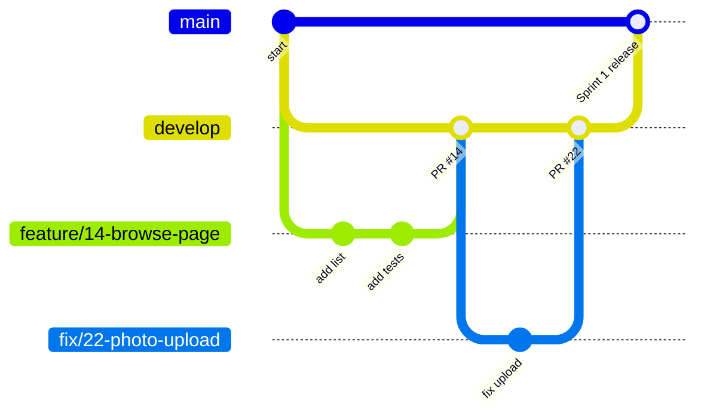

# Contributing to Naija Kitchen

This is how we work on the repo as a team. Everyone follows it, including for small changes.

## Branching

We use a simple Git Flow: two long-lived branches, and a short-lived branch for every card.

### The two branches that always exist

| Branch | What's on it | Deploys to | Who changes it |
|---|---|---|---|
| `main` | The live app. Always working. | Live site on Vercel | Only through a release PR from `develop`, or a hotfix PR |
| `develop` | Everything finished this sprint. Should always build and pass tests. | Staging site on Vercel | Only through reviewed PRs from card branches |

Nobody commits to `main` or `develop` directly, even for a one-line fix. Both are protected.

### Card branches

Every card on the board gets its own branch. One card = one branch = one PR.

| Type | Branch from | Merge into | Example |
|---|---|---|---|
| `feature/` | `develop` | `develop` | `feature/14-browse-page` |
| `fix/` | `develop` | `develop` | `fix/22-photo-upload` |
| `test/` | `develop` | `develop` | `test/28-api-integration` |
| `ci/` | `develop` | `develop` | `ci/11-github-actions` |
| `docs/` | `develop` | `develop` | `docs/6-contributing` |
| `hotfix/` | `main` | `main`, then `develop` | `hotfix/51-login-crash` |

Naming rules:

- Type, then the issue number, then 2–4 words: `feature/14-browse-page`
- Lowercase, hyphens not spaces
- The number must match the card, so the branch, PR and card all link up

### How the branches fit together



### Working on a card, start to finish

**1. Pick it up.** Take a card from **Ready**, assign yourself, move it to **In progress**. Don't start a card that says "Blocked by #n" until that card is done.

**2. Create your branch from the latest `develop`.**

```bash
git checkout develop
git pull
git checkout -b feature/14-browse-page
```

**3. Commit as you go, and push early.** Push your branch the first day, even if it's not finished, so the team can see it and nothing is lost if your laptop dies.

```bash
git add .
git commit -m "Add recipe card component (#14)"
git push -u origin feature/14-browse-page
```

After the first push, `git push` is enough.

**4. Keep your branch up to date.** Other people's work lands on `develop` while you're working. Pull it into your branch at least once a day, and always before opening a PR:

```bash
git checkout develop
git pull
git checkout feature/14-browse-page
git merge develop
```

We merge `develop` into our branches; we don't rebase. That way nobody needs to force-push.

**5. Open the PR** into `develop` (see [Pull requests](#pull-requests)).

**6. After it's merged,** delete the branch on GitHub (there's a button on the PR) and locally:

```bash
git checkout develop
git pull
git branch -d feature/14-browse-page
```

### Merge conflicts

Conflicts happen when two people change the same lines. If `git merge develop` reports one:

1. Open the files Git lists. Look for the `<<<<<<<`, `=======` and `>>>>>>>` markers.
2. Keep the right code (often a bit of both) and delete the markers.
3. Run the app and tests to check it still works.
4. `git add` the fixed files, then `git commit`.

If you're not sure which version is right, ask the person who wrote the other change. Don't just delete their code.

To avoid conflicts: keep branches small, merge `develop` in often, and say in the team chat if you're about to change a shared file (e.g. the Prisma schema, routes, or global styles).

### Branch rules

- Branches should be short. Aim to merge within 2–3 days. If a card is taking longer, split it.
- One person per branch. If you need to build on someone else's unmerged work, wait for it to merge, or agree it with them first.
- Never force-push to a branch someone else is using, and never to `main` or `develop`.
- Don't reuse a branch for a second card. Start a new one from `develop`.
- Delete branches once they're merged so the branch list stays clean.

## Commits

- Keep them small. One change per commit.
- Start with a verb and put the issue number at the end: `Add recipe card component (#14)`
- Don't commit `.env` files, secrets or `node_modules`. Use `.env.example` for new environment variables.
- New source files get the Apache 2.0 licence header.

## Before you open a pull request

Run these locally and make sure they pass:

```bash
npm run lint
npm run format:check
npm test
```

If you changed the database schema, include the Prisma migration in the same PR.

## Pull requests

- Open the PR into `develop` (or into `main` for a hotfix).
- Fill in the PR template and write `Closes #14` so the card closes itself when the PR is merged.
- Add screenshots for any UI change, and check it against the Figma design.
- Vercel adds a preview link to every PR. Reviewers should open it and try the change.
- Keep PRs small enough to review in about 15 minutes. Split big cards if you need to.
- Move the card to **In review**.

## Reviews

- Every PR needs **one approval from someone else** before it's merged. You can't merge your own PR.
- The GitHub Actions checks (lint, tests, build) must be green.
- Reviewers: pull the branch and try it, don't just read the code. Comment on anything unclear, and use "Request changes" if something needs fixing.
- Try to review within 24 hours. Mention people in the team chat if a PR is waiting.
- Use **Squash and merge** so each card is one commit on `develop`, then delete the branch.
- Release PRs from `develop` into `main` use a normal **Merge commit**, not squash, so `main` keeps the full history.

## Tests

- New logic gets **unit tests** (Vitest).
- New or changed API routes get **integration tests** (Vitest, against a test database).
- Main user journeys are covered by **end-to-end tests** (Playwright).
- Coverage can't drop below the minimum set in the pipeline.

## Releasing

At the end of each sprint, once staging has been checked:

1. Open a PR from `develop` into `main`, titled e.g. `Sprint 1 release`.
2. The whole team reviews it, and at least one person approves.
3. Merging deploys the live site on Vercel.
4. Check the live site and the monitoring dashboard afterwards.

5. Tag the release on `main`, e.g. `v0.1.0` for Sprint 1, `v0.2.0` for Sprint 2.

### Hotfixes

Only for a bug on the live site that can't wait until the next release.

1. Branch from `main`: `git checkout main && git pull && git checkout -b hotfix/51-login-crash`
2. Fix it, add a test that would have caught it, and open a PR into `main`.
3. After it's merged and deployed, open a second PR from `main` into `develop` so the fix isn't lost at the next release.

## Definition of done

A card only goes to **Done** when:

- [ ] Everything on the card's "Done when" list is ticked
- [ ] Tests are written and passing in CI
- [ ] The PR has been reviewed, approved and merged
- [ ] It works on staging
- [ ] Any docs or README changes are made

## Weekly scrum

We have a scrum each week in class. Each person says what they did, what they're doing next and what's blocking them. Notes go on the scrum notes page (card #12).

## Licence

By contributing you agree that your work is licensed under the [Apache License 2.0](LICENSE).
