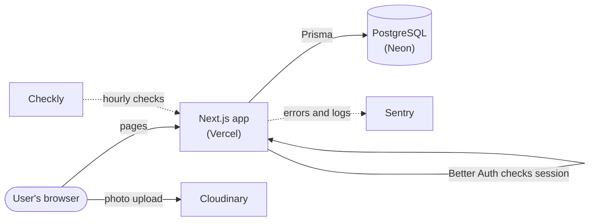

# Naija Kitchen tech stack

Naija Kitchen runs as one Next.js app on Vercel. This file lists what we use and why. If you want to change something here, open an issue first so the team can agree it.

## At a glance

| Part | Tool | What it does |
|---|---|---|
| App | **Next.js** + TypeScript | Front end (pages) and back end (API routes) in one project |
| Styling | **Tailwind CSS** | Styles pages with utility classes, including dark mode |
| Database | **PostgreSQL on Neon** | Stores users, recipes, comments, likes and sessions in the cloud |
| Database access | **Prisma** | Lets us query Postgres in TypeScript and version-controls table changes |
| Login | **Better Auth** | Sign up, login, logout, password hashing and sessions, saved via Prisma |
| Photos | **Cloudinary** | The browser uploads photos straight to Cloudinary, and we only save the URL |
| Code quality | **ESLint + Prettier**, npm + lockfile | Catches mistakes and keeps formatting consistent |
| Testing | **Vitest** (+ next-test-api-route-handler), **Playwright** | Unit tests, API tests and coverage; full browser tests |
| CI | **GitHub Actions** | Runs lint, tests and the build on every PR and push |
| Hosting | **Vercel** | `main` goes live, `develop` is staging, and every PR gets a preview link |
| Live checks | **Checkly** | Runs our Playwright tests and API checks on the live site every hour and alerts us if one fails |
| Errors and logs | **Sentry** | Catches errors real users hit, keeps logs for 30 days, and records how fast pages and API calls are |
| Analytics | **Vercel Web Analytics + Speed Insights** | Shows visitor numbers and page speed in the Vercel dashboard |
| Design | **Figma** | Mockups and style guide |

## How it fits together

Example, creating a recipe:

1. The user fills in the form on a Next.js page styled with Tailwind.
2. The photo uploads straight to Cloudinary, which returns a URL.
3. The form sends the recipe and photo URL to a Next.js API route.
4. Better Auth checks the session cookie to see who the user is.
5. Prisma saves the recipe into Postgres on Neon.
6. The new recipe is sent back and shown on the page.

## Why we chose each one

### Next.js + TypeScript
One project holds both the pages and the API, so there's one repo, one build and one deploy, and no separate back end to keep in sync. Pages can be rendered on the server, which makes the recipe pages load fast and show up properly in search results. TypeScript catches mistakes like typos in property names before the code runs, and the pages and API share the same types.
**Trade-off:** Next.js has more to learn than plain React (server vs client components, routing rules), and it ties us more closely to Vercel's way of doing things.
[nextjs.org](https://nextjs.org/) · [typescriptlang.org](https://www.typescriptlang.org/)

### Tailwind CSS
- **Faster to build:** styles go straight on the elements, so we rarely switch to a separate CSS file.
- **Consistent design:** our Figma colours and fonts are set once as theme variables, and everyone picks from the same spacing and sizes.
- **Fewer merge conflicts:** there's no big shared CSS file for four people to edit at once.
- **Responsive and dark mode built in:** `md:` changes the layout on bigger screens, and `dark:` plus our theme variables handle dark mode (card #26).
- **Small CSS file:** only the classes we use end up in the build.

**Trade-off:** class lists get long and take a few days to learn. We turn repeated patterns (buttons, recipe cards) into React components instead of copying classes around.
[tailwindcss.com](https://tailwindcss.com/) · [Dark mode docs](https://tailwindcss.com/docs/dark-mode)

### PostgreSQL on Neon
Our data is relational (users have recipes, recipes have ingredients, steps, likes and comments), so a relational database fits. Neon gives us a free hosted Postgres database, and its branching makes a separate staging database easy.
**Trade-off:** the free tier pauses when idle, so the first request after a quiet spell can be slow.
[postgresql.org](https://www.postgresql.org/) · [neon.com](https://neon.com/)

### Prisma
We define the tables in one schema file and get type-safe queries in TypeScript. Migrations keep everyone's database the same shape, and every schema change shows up in Git and goes through review.
**Trade-off:** it's another tool to learn, and complex queries can be harder to write than raw SQL.
[prisma.io](https://www.prisma.io/)

### Better Auth
Handles sign up, login, logout, password hashing and sessions for us, so we don't write security-critical code from scratch. It works with Next.js and stores users and sessions in our own database through Prisma, so we keep control of the data.
**Trade-off:** it's newer than some alternatives, so there are fewer tutorials and answers online.
[better-auth.com](https://www.better-auth.com/)

### Cloudinary
Photos upload from the browser straight to Cloudinary, so they never pass through our server or fill up our database. Cloudinary resizes them, so thumbnails load quickly. We only save the image URL in Postgres.
**Trade-off:** uploads must be signed or use a locked-down upload preset, or anyone could upload to our account.
[cloudinary.com](https://cloudinary.com/) · [Upload docs](https://cloudinary.com/documentation/upload_images)

### Vitest + Playwright
- **Vitest** for unit tests and coverage. With **next-test-api-route-handler** it also runs integration tests that call our API routes against a test database, without starting the whole site. We don't need Supertest, which only works with Express.
- **Playwright** for end-to-end tests that click through the site like a real user. It also covers what Vitest can't test: async Server Components and Server Actions.

Together these cover the three levels the brief asks for: unit, integration and acceptance.
**Trade-off:** API tests need their own test database (a spare Neon branch) so they never touch real data.
[vitest.dev](https://vitest.dev/) · [playwright.dev](https://playwright.dev/) · [Next.js Vitest guide](https://nextjs.org/docs/app/guides/testing/vitest)

### ESLint + Prettier
ESLint flags likely bugs and bad patterns. Prettier formats the code the same way for everyone, so reviews are about the logic, not spacing.
[eslint.org](https://eslint.org/) · [prettier.io](https://prettier.io/)

### npm with a committed lockfile
The lockfile pins the exact version of every package, so the app installs the same way on everyone's laptop, in CI and on Vercel. CI uses `npm ci`, which installs straight from the lockfile.
[npm docs: package-lock.json](https://docs.npmjs.com/cli/configuring-npm/package-lock-json)

### GitHub Actions
Built into GitHub and free for our use. It runs lint, tests and the build on every push and pull request, and a PR can't merge if it fails. The brief asks for it specifically.
[GitHub Actions docs](https://docs.github.com/en/actions)

### Vercel
Made by the Next.js team, so it runs Next.js with almost no setup. It deploys automatically from GitHub, gives every pull request its own preview link for reviewers to try, and keeps a history of deploys we can roll back to.
**Trade-off:** we depend on one provider, and the free tier has usage limits.
[vercel.com](https://vercel.com/) · [Next.js on Vercel](https://vercel.com/docs/frameworks/nextjs)

### Monitoring and logging: Checkly + Sentry + Vercel Analytics
Our tests only check the code before it goes live. These tools watch the live site after.
- **Checkly** reruns our Playwright tests and API checks on the live site every hour and emails or Slacks us if something breaks. We write each test once and use it twice: in CI and on the live site.
- **Sentry** records errors real users hit, keeps logs for 30 days and tracks how fast pages and API calls are. We need it because Vercel's free plan only keeps 1 hour of logs, and sending logs elsewhere (drains) needs the paid plan.
- **Vercel Web Analytics + Speed Insights** are built into Vercel and show visits and page speed.

In short: Checkly tells us something broke, Sentry tells us why. All three are free.
**Trade-off:** Checkly and Sentry only allow 1 user on the free plan, so one of us owns each account and alerts go to the team chat. Checkly's free plan covers about one browser check per hour.
[checklyhq.com](https://www.checklyhq.com/) · [sentry.io](https://sentry.io/) · [Vercel Analytics](https://vercel.com/docs/analytics) · [Vercel free plan limits](https://vercel.com/docs/plans/hobby)

## Environments

| Environment | Branch | Where it runs | Database |
|---|---|---|---|
| Local | your branch | `localhost:3000` | Your own Neon branch or local Postgres |
| CI tests | any PR or push | GitHub Actions | Neon test database |
| PR preview | any PR | Vercel preview link | Neon staging database |
| Staging | `develop` | Vercel (staging URL) | Neon staging database |
| Live | `main` | Vercel production | Neon live database |

## Secrets and environment variables

Never commit secrets. Every variable the app needs is listed, without real values, in `.env.example`. Real values live in Vercel and GitHub Actions secrets.

| Variable | What it's for |
|---|---|
| `DATABASE_URL` | Neon connection string |
| `BETTER_AUTH_SECRET` | Signs sessions |
| `BETTER_AUTH_URL` | The app's own address |
| `CLOUDINARY_CLOUD_NAME` | Cloudinary account |
| `CLOUDINARY_API_KEY` | Cloudinary account |
| `CLOUDINARY_API_SECRET` | Signs uploads (server only, never sent to the browser) |
| `NEXT_PUBLIC_SENTRY_DSN` | Tells the app where to send errors and logs in Sentry |
| `SENTRY_AUTH_TOKEN` | Lets the build upload source maps to Sentry (CI and Vercel only) |
| `CHECKLY_API_KEY` | Lets CI deploy our checks to Checkly |
| `CHECKLY_ACCOUNT_ID` | Our Checkly account |
