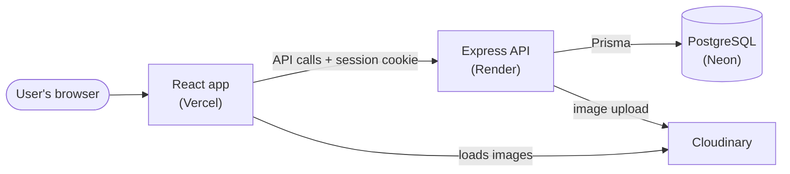

# Naija Kitchen tech stack

What we're building with, and why we picked it. If you want to change something here, open an issue first so the team can agree it.

## At a glance

| Area | What we use |
|---|---|
| Language | TypeScript (front end and back end) |
| Front end | React, built with Vite |
| Styling | Tailwind CSS |
| Back end | Node.js with Express |
| Database | PostgreSQL, hosted on Neon |
| Database access | Prisma |
| Login | bcrypt + express-session, sessions stored in Postgres (connect-pg-simple) |
| Photo uploads | multer + Cloudinary |
| Testing | Vitest (unit + coverage), Supertest (API), Playwright (end-to-end) |
| Code quality | ESLint + Prettier |
| Packages | npm, with `package-lock.json` committed |
| CI/CD | GitHub Actions |
| Hosting | Front end on Vercel, API on Render |
| Design | Figma |

## How it fits together

- The React app runs in the browser and calls the Express API.
- The API handles logins, recipes, likes and comments, and talks to the database through Prisma.
- Photos go from the API to Cloudinary. We only store the image URL in Postgres.
- Sessions are stored in Postgres too, so logins survive a server restart.

## Why we chose each one

### TypeScript
Catches mistakes like typos in property names before the code runs. Using it on both sides means the front end and back end can share the same types for things like a recipe.
[typescriptlang.org](https://www.typescriptlang.org/)

### React + Vite
React is what most of the team already knows, and it's widely used, so help is easy to find. Vite starts and reloads much faster than older tools.
[react.dev](https://react.dev/) · [vite.dev](https://vite.dev/)

### Tailwind CSS
- **Faster to build:** styles go straight on the elements, so we rarely switch to a separate CSS file.
- **Consistent design:** our Figma colours and fonts are set once as theme variables, and everyone picks from the same spacing and sizes, so pages match even when different people build them.
- **Fewer merge conflicts:** there's no big shared CSS file for four people to edit at once.
- **Responsive and dark mode built in:** `md:` changes the layout on bigger screens, and `dark:` plus our theme variables handle dark mode (card #26).
- **Small CSS file:** only the classes we use end up in the build, so pages load quickly.

**Trade-off:** the class lists in our components get long, and the class names take a few days to learn. To keep it tidy, we turn repeated patterns (buttons, recipe cards) into React components instead of copying the same classes around.
[tailwindcss.com](https://tailwindcss.com/) · [Dark mode docs](https://tailwindcss.com/docs/dark-mode)

### Node.js + Express
Same language as the front end, so anyone on the team can work on either side. Express is simple and well documented.
[nodejs.org](https://nodejs.org/) · [expressjs.com](https://expressjs.com/)

### PostgreSQL on Neon
Our data is relational (users have recipes, recipes have ingredients, steps, likes and comments), so a relational database fits. Neon gives us a free hosted Postgres database without managing a server.
[postgresql.org](https://www.postgresql.org/) · [neon.com](https://neon.com/)

### Prisma
Lets us define the database tables in one schema file and get type-safe queries in TypeScript. Its migrations keep everyone's database the same shape, and every schema change shows up in Git.
[prisma.io](https://www.prisma.io/)

### bcrypt + express-session (not JWT)
bcrypt hashes passwords so we never store them in plain text. We went with server-side sessions over JWT because sessions are simpler to get right, and logging out actually ends the session straight away. Storing sessions in Postgres with connect-pg-simple means they aren't lost when Render restarts the API.
[bcrypt](https://www.npmjs.com/package/bcrypt) · [express-session](https://github.com/expressjs/session) · [connect-pg-simple](https://github.com/voxpelli/node-connect-pg-simple)

### multer + Cloudinary
multer handles the file upload in Express. Cloudinary stores and resizes the images, so we don't fill up our server or database with photos, and thumbnails load quickly.
[multer](https://github.com/expressjs/multer) · [cloudinary.com](https://cloudinary.com/)

### Vitest, Supertest and Playwright
- **Vitest** for unit tests and coverage. It works with Vite out of the box.
- **Supertest** for testing API routes without starting a real server.
- **Playwright** for end-to-end tests that click through the site like a real user.

These cover the three levels of testing the brief asks for: unit, integration and acceptance.
[vitest.dev](https://vitest.dev/) · [Supertest](https://github.com/ladjs/supertest) · [playwright.dev](https://playwright.dev/)

### ESLint + Prettier
ESLint flags likely bugs and bad patterns. Prettier formats the code the same way for everyone, so reviews are about the logic, not spacing.
[eslint.org](https://eslint.org/) · [prettier.io](https://prettier.io/)

### npm with a committed lockfile
The lockfile pins the exact version of every package, so the app installs the same way on everyone's laptop, in CI and on the hosts. CI uses `npm ci`, which installs straight from the lockfile.
[npm docs: package-lock.json](https://docs.npmjs.com/cli/configuring-npm/package-lock-json)

### GitHub Actions
Built into GitHub, free for our use, and runs lint, tests and the build on every push and pull request. The brief asks for it specifically.
[GitHub Actions docs](https://docs.github.com/en/actions)

### Vercel (front end) + Render (API)
Vercel is built for front-end apps like ours: fast to deploy, with a preview link for each branch. Render runs our Express API as a normal Node server, which Vercel isn't designed for. Both deploy automatically from GitHub.
[vercel.com](https://vercel.com/) · [render.com](https://render.com/)

## Environments

| Environment | Branch | Front end | API | Database |
|---|---|---|---|---|
| Local | your branch | `localhost` (Vite) | `localhost` (Express) | Your own Neon branch or local Postgres |
| Staging | `develop` | Vercel preview | Render staging service | Neon staging database |
| Live | `main` | Vercel production | Render live service | Neon live database |

Because the front end and API are on different domains:

- The API's CORS settings must allow the Vercel domain.
- The session cookie must use `sameSite: "none"` and `secure: true`, or logins won't work on the hosted site.
- The front end reads the API address from `VITE_API_URL`, which is set separately on Vercel for staging and live.

## Secrets and environment variables

Never commit secrets. Every variable the app needs is listed, without real values, in `.env.example`. Real values live in Vercel, Render and GitHub Actions secrets.

| Variable | Used by | What it's for |
|---|---|---|
| `DATABASE_URL` | API | Neon connection string |
| `SESSION_SECRET` | API | Signs the session cookie |
| `CLOUDINARY_URL` | API | Cloudinary account details |
| `FRONTEND_URL` | API | Allowed origin for CORS |
| `VITE_API_URL` | Front end | Where the API lives |

## Still to decide

- **Monitoring and logging tools** (card #34): what we use for uptime checks, metrics and logs.
